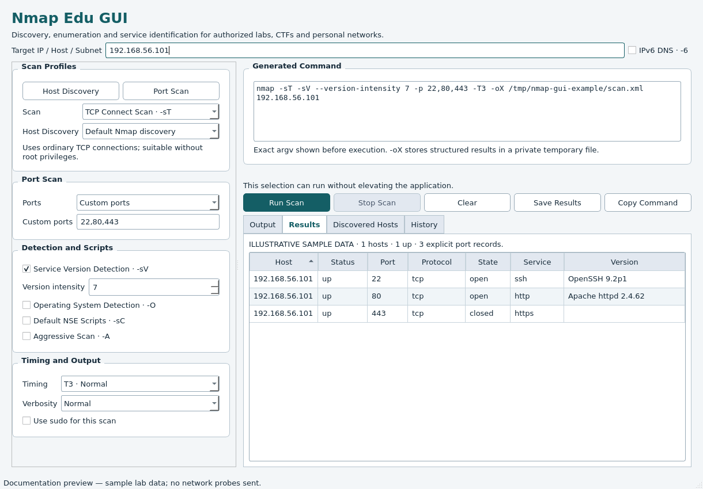

# Nmap Edu GUI

A Python 3 / PyQt6 desktop interface for learning and using the real Nmap on Kali Linux. Select a target and scan options, review the exact command, then watch output arrive while the scan runs. Read structured host and port results without leaving the app.

**This project is intended for authorized security testing, cybersecurity education, CTF environments and personal lab networks. Do not scan systems without permission.**

Independent educational project; not an official Nmap product. Version 0.1.0 is an MVP for lab use.

## Screenshots



Screenshots show the actual Qt interface populated with **illustrative sample lab data**. They do not represent scans performed against those addresses. Also see [streaming console layout](screenshots/output.png) and [discovered hosts](screenshots/discovered-hosts.png).

## Features

- One validated IPv4, IPv6, CIDR subnet or ASCII DNS hostname per scan.
- Host Discovery and Port Scan profile buttons, with tooltips explaining each technique.
- Ping Scan `-sn`; default discovery, `-Pn`, `-PS`, `-PA` and `-PU`.
- SYN `-sS`, TCP Connect `-sT`, UDP `-sU` and ACK `-sA` scans.
- Default ports, top 10/100/1000 ports, all ports, and custom comma-separated ports/ranges.
- Service detection `-sV`, version intensity 0–9, OS detection `-O`, default scripts `-sC` and aggressive mode `-A`.
- Timing T0–T5 (T3 by default), normal/verbose/very verbose output.
- Automatically updated **Generated Command**, including the actual XML file path and any sudo arguments.
- Non-blocking stdout/stderr streaming, elapsed time, Stop Scan and shutdown cancellation.
- Monospace output console, Clear, Copy Output, Copy Command and Save Results (raw text).
- **Results**: Host, Status, Port, Protocol, State, Service, Version.
- **Discovered Hosts**: IP Address, Hostname, Status, MAC Address, Vendor.
- SQLite **History**: start timestamp in UTC, target, exact argv, options, duration, outcome, exit code, raw output and XML. Reopen, copy commands or rerun scans.
- Explicit sudo selection for privileged scans; only Nmap is elevated. No saved passwords.
- Consistent light colors with readable disabled controls, selections and dialogs, including on desktops using a dark system theme.

## Requirements

- Kali Linux or a compatible Linux desktop, with an X11 or Wayland session.
- Python **3.11 or newer** and `venv` support.
- Nmap installed and available on `PATH`.
- PyQt6 6.8 or newer (installed by pip).
- `sudo` and an authorized sudo account for privileged techniques.

Check Nmap first:

```bash
nmap --version
```

If necessary, install the system prerequisites:

```bash
sudo apt update
sudo apt install nmap python3-venv
```

The GUI also reports a clear error when Nmap is missing. Qt needs the Linux platform libraries documented in [Qt's Linux requirements](https://doc.qt.io/qt-6/linux-requirements.html). For an `xcb` / cursor library error on Kali, check that `libxcb-cursor0` is installed.

## Installation

Replace `YOUR_USERNAME` with the owner of your published repository:

```bash
git clone https://github.com/YOUR_USERNAME/nmap-gui.git
cd nmap-gui
python3 -m venv .venv
source .venv/bin/activate
pip install -r requirements.txt
python -m nmap_gui.main
```

`requirements.txt` installs this project in editable mode, including its PyQt6 dependency. This makes the `src/` layout importable from the documented module command. You can also launch it with:

```bash
nmap-gui
```

Do not launch the whole application with sudo.

## Usage

1. Enter an authorized **Target IP / Host / Subnet**.
2. Choose Host Discovery or a Port Scan technique, then configure ports and detection.
3. Review **Generated Command**. Invalid inputs disable Run Scan and explain the problem.
4. For a privileged technique, explicitly select **Use sudo for this scan**.
5. Click **Run Scan**. Output appears as Nmap produces it; options stay locked during the run.
6. Use **Stop Scan** to cancel. Inspect **Results**, **Discovered Hosts**, or the raw **Output**.
7. Use **Save Results** to save raw text. **Clear** clears the visible console; completed output remains available for saving and in History.

Ping Scan disables port selection, service/OS detection and scripts; those inactive values are excluded from its command. Skip discovery (`-Pn`) is unavailable with Ping Scan. Aggressive mode enables OS detection, version detection, default scripts and traceroute without repeating `-O`, `-sV` or `-sC`.

### Privileges and sudo authentication

The app flags SYN, UDP, ACK, OS detection, aggressive mode and UDP/ACK discovery as requiring elevation. It conservatively requests elevation for ACK discovery, even though Nmap may offer limited fallbacks in some configurations. Ordinary TCP Connect and Ping Scan can run as the desktop user. TCP SYN discovery can use Nmap's unprivileged connect fallback.

When **Use sudo** is selected, the generated argv starts with `sudo -A -- nmap`. The installed `nmap-gui-askpass` helper runs a separate, unprivileged password dialog if sudo needs authentication. Its response goes directly to sudo's askpass pipe. The main GUI, SQLite history and output console never receive the password. Cancelling authentication makes sudo fail without launching the scan.

Authentication and signal forwarding remain subject to the system's sudo policy. NOPASSWD/cached authentication may skip the dialog. A working graphical session is required when a password prompt is needed. Reinstall with `pip install -r requirements.txt` if the helper is missing.

### Targets and ports

Accepted examples:

```text
192.168.56.101
192.168.56.0/24
2001:db8::1
2001:db8::/64
scanme.nmap.org
```

Hostnames are validated syntactically, without contacting DNS during editing; Nmap resolves them during execution. CIDRs are normalized to their network address: `192.168.56.42/24` becomes `192.168.56.0/24`. IPv6 literals/CIDRs automatically add `-6`; use **IPv6 DNS** for hostname scans over IPv6. IPv6 scope IDs, URLs, target files, wildcard/range targets and multiple targets are not supported.

Custom ports use numbers 1–65535 and ascending ranges:

```text
22
22,80,443
1-1000
22,80,443,8000-9000
```

### Examples

These examples omit the automatically added `-oX /private/temporary/scan.xml` for readability. The GUI displays and copies the **full** command actually executed.

| Goal | Selections | Command |
| --- | --- | --- |
| Discover lab hosts | Host Discovery, Ping Scan | `nmap -sn -T3 192.168.56.0/24` |
| Identify selected TCP services | TCP Connect, Service Detection, custom ports | `nmap -sT -sV --version-intensity 7 -p 22,80,443 -T3 192.168.56.101` |
| Privileged SYN scan | SYN, Top 100, Use sudo | `sudo -A -- nmap -sS --top-ports 100 -T3 192.168.56.101` |
| IPv6 loopback | TCP Connect, target `::1` | `nmap -6 -sT -T3 ::1` |

The builder is usable independently of Qt:

```python
from nmap_gui.command_builder import NmapCommandBuilder

command = (
    NmapCommandBuilder()
    .set_target("192.168.56.101")
    .enable_syn_scan()
    .enable_service_detection()
    .set_ports("22,80,443")
    .build()
)
# ['nmap', '-sS', '-sV', '--version-intensity', '7', '-p', '22,80,443', '-T3', '192.168.56.101']
```

### History and local data

History defaults to `$XDG_STATE_HOME/nmap-edu-gui/history.db`, or `~/.local/state/nmap-edu-gui/history.db` when that variable is unset. The database file is mode `0600`; it is not encrypted. Results can contain sensitive inventory data.

Override the location if needed:

```bash
python -m nmap_gui.main --history-db ./results/history.db
```

The History tab displays the most recent 200 records; older records remain in SQLite. Select a record, then **Open Results**, **Copy Command**, or **Rerun Scan**. Rerun restores and validates its saved options and creates a fresh XML path. It never executes the stored command text. A copied historical command includes its original temporary path, which may no longer exist; rerun from History to regenerate it.

Raw output and XML are saved for completed, failed and stopped scans. In-progress scans are not crash-recovered. If history cannot be opened or written, the History tab reports the error and scanning remains usable.

## Architecture

```text
nmap-gui/
├── README.md, LICENSE, CONTRIBUTING.md, DEVELOPMENT.md
├── requirements.txt, pyproject.toml, MANIFEST.in, .gitignore
├── .github/workflows/tests.yml
├── src/nmap_gui/
│   ├── __init__.py
│   ├── main.py               # Entry point and CLI arguments
│   ├── gui.py                # Qt widgets and presentation
│   ├── theme.py              # Consistent light palette and readable widget states
│   ├── command_builder.py    # Validated argv and command preview
│   ├── scanner.py            # QThread + subprocess, streaming and cancellation
│   ├── parser.py             # ElementTree XML → host/port/service objects
│   ├── validators.py         # IP/CIDR/hostname and port validation
│   ├── database.py           # SQLite history with parameterized SQL
│   ├── models.py             # Shared dataclasses
│   └── askpass.py            # Separate sudo authentication prompt
├── tests/                    # Unit, Qt and subprocess integration tests
│   └── fixtures/lab.xml      # Clearly labelled illustrative data
├── scripts/capture_screenshots.py
└── screenshots/
```

The scanner executes argv lists with `subprocess.Popen(..., shell=False)`. A QThread reads stdout and stderr with selectors and incremental UTF-8 decoders, then sends Qt signals to the GUI. No widget is accessed from the worker thread. The textual order between separate stdout/stderr pipes reflects arrival order, not a guaranteed ordering between Nmap's writes.

Nmap writes XML to a private, mode-0600 file inside a temporary directory, while human-readable output continues on stdout. The command preview contains this actual path. XML is parsed after completion; interrupted scans can recover completed `<host>` elements. Files are removed on normal application shutdown; persistent copies live in SQLite.

Stop sends SIGINT to the scan process group, then SIGTERM after three seconds and SIGKILL after five seconds if needed. Closing the window requests cancellation and waits asynchronously for the worker to finish. sudo relays catchable signals to its child, subject to platform/policy behavior.

## Security Notes

- Use only systems you own or have explicit permission to test. Default scripts and aggressive scans can be intrusive.
- No `os.system`, shell command interpolation, or `shell=True`. Display quoting uses `shlex.join` only; execution always uses a list.
- Target/port allowlists reject shell operators, substitutions, control characters, option-looking targets and unsupported syntax, including `;`, `&&`, `||`, backticks and `$()`.
- Privileged execution is explicit and applies only to Nmap. Passwords are not persisted or sent through the main GUI.
- SQL uses bound parameters. Historical reruns rebuild validated options instead of trusting executable command strings from the database.
- XML parsing uses `xml.etree.ElementTree`, rejects entity declarations, and limits accepted XML to 64 MiB of characters.
- No automatic exploitation, credential attacks, script chaining or offensive workflows are implemented.

## Current limitations

- Linux desktop only; small/medium lab scans are the intended workload. Raw output and XML are retained in memory as well as history.
- Structured results appear after the scan ends, while the raw console streams during execution.
- Tables show explicit XML port records. Nmap can summarize uninteresting ports in `<extraports>`; these aggregates are not expanded into invented rows.
- MAC/vendor information depends on network visibility and Nmap privileges; absent fields remain blank.
- Stop may leave incomplete XML. Raw output is retained even if structured parsing fails.
- Save Results currently exports **raw text**. XML is stored internally in history; dedicated XML/JSON/CSV export is on the roadmap.
- Real sudo authentication and privileged scans require validation on the target Kali desktop; restricted containers may forbid elevation or all network sockets.

## Development and tests

```bash
source .venv/bin/activate
pip install -e '.[dev]'
python -m pytest -q
python -m nmap_gui.main --version
python -m build
```

The tests cover validation/injection rejection, argv generation, XML parsing and partial recovery, SQLite persistence, GUI state, history reopen/rerun, and subprocess streaming/cancellation. Tests never contact external targets. One integration test probes an ephemeral TCP listener on `127.0.0.1`; it is skipped if Nmap is absent or sockets are forbidden. A separate real `nmap -sL -n` test checks XML generation without network probes.

Qt tests use the offscreen platform automatically. Recreate documentation screenshots without scans:

```bash
QT_QPA_PLATFORM=offscreen QT_QPA_PLATFORMTHEME= QT_STYLE_OVERRIDE=Fusion \
  python scripts/capture_screenshots.py
```

See [DEVELOPMENT.md](DEVELOPMENT.md) for the incremental implementation checkpoints, validation record and manual Kali acceptance steps. GitHub Actions runs tests and packaging on Python 3.11 and 3.14.

## Roadmap

- [ ] NSE script selection
- [ ] Export JSON / CSV / XML
- [ ] Dark mode
- [ ] Network topology view
- [ ] Scan comparison
- [ ] Saved and custom scan profiles
- [ ] Search/filter for results and history
- [ ] Plugin system with explicit, reviewed capabilities

Future work remains focused on authorized discovery, enumeration, service identification and analysis.

## Contributing

See [CONTRIBUTING.md](CONTRIBUTING.md). Keep command building, validation, execution, XML parsing, persistence and presentation separate. Add focused tests for behavior changes and explain any privilege implications.

To publish your prepared local repository, create an empty public `nmap-gui` repository in your GitHub account, then configure its URL:

```bash
git remote add origin https://github.com/YOUR_USERNAME/nmap-gui.git
git push -u origin main
```

Do not commit scan results, databases, credentials or virtual environments.

## License

Project source: [MIT](LICENSE). Dependencies retain their own licenses. PyQt6 is distributed under GPLv3 or a commercial Riverbank license; the MIT license here does not override its terms. Review the applicable dependency licenses before redistributing a combined application. Nmap is a separately installed executable; see its own licensing terms.

## References

- [Nmap scan techniques](https://nmap.org/book/man-port-scanning-techniques.html)
- [Nmap output and XML](https://nmap.org/book/man-output.html)
- [Python subprocess](https://docs.python.org/3/library/subprocess.html)
- [PyQt6 documentation](https://www.riverbankcomputing.com/static/Docs/PyQt6/)
- [sudo manual](https://www.sudo.ws/docs/man/sudo.man/)
